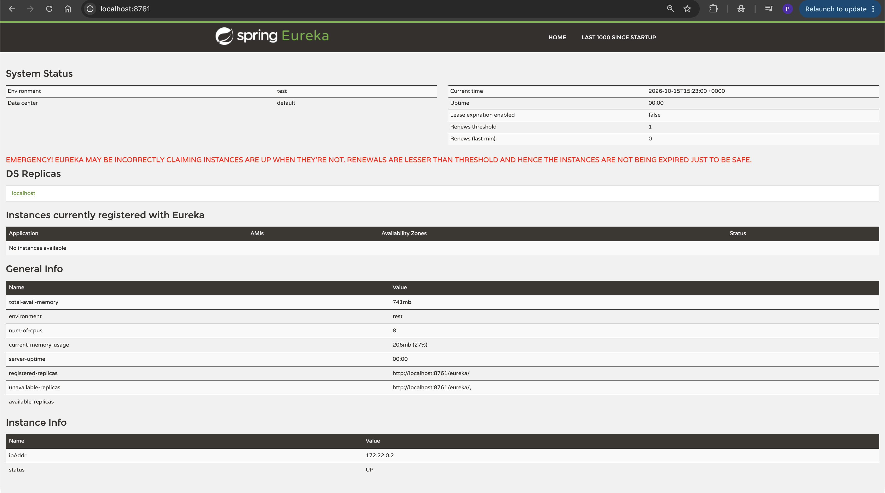

# Bookstore App — DevOps From-Scratch Project Log

> **Purpose:** Maintain a practical, chronological record of the DevOps work completed on the sample Book Store application, the problems encountered, the commands used, the decisions made, and the remaining work.
>
> **Repository branch:** `devops-from-scratch`  
> **Repository root (current machine):** `~/Desktop/ACG/Task-3/sample-book-store-app`  
> **Last updated:** 2026-10-15  
> **Status:** Source builds verified locally; DevOps infrastructure and deployment are not yet implemented.

---

## 1. Project objective

Build and explain a DevOps delivery path from source code to a publicly accessible application, using the existing Book Store repository as **application source and inspiration only**. Create our own DevOps configuration rather than adopting the repository's existing infrastructure/configuration.

### Intended delivery flow

1. Developer pushes code to GitHub.
2. GitHub Actions checks out the code and runs validation/build steps.
3. The frontend is built and packaged for static hosting.
4. Backend service Docker images are built and pushed to Amazon ECR.
5. Backend services run on Amazon EKS, initially using EC2 worker nodes.
6. The frontend is hosted in Amazon S3 and delivered through CloudFront.
7. The backend connects to Amazon Aurora MySQL-Compatible.
8. The application is tested through a public URL and the end-to-end flow is documented for manager review.

### Scope decisions

- Build the AWS network from scratch; no pre-existing VPC is assumed.
- No custom domain is available. Use the generated CloudFront hostname for the frontend and the ALB DNS name for direct backend checks where appropriate.
- Use GitHub Actions for CI/CD.
- Prefer GitHub OIDC federation to AWS instead of long-lived AWS access keys.
- Use Amazon ECR for backend container images, Amazon EKS for backend workloads, S3 + CloudFront for the frontend, and Aurora MySQL-Compatible for the database.
- Do **not** reuse the repository's existing Prometheus, Grafana, Telegraf, Jenkins, Docker Compose, or infrastructure deployment configuration as the solution. Do not delete those files; leave them untouched and out of the new workflow.
- Keep AWS cost exposure under control. Do not provision paid AWS resources until the design, expected costs, and explicit go-ahead have been reviewed.

---

## 2. Repository overview

Repository: `https://github.com/soumyaparida00/sample-book-store-app`

Relevant root entries observed:

- `bookstore-account-service/`
- `bookstore-api-gateway-service/`
- `bookstore-billing-service/`
- `bookstore-catalog-service/`
- `bookstore-commons/`
- `bookstore-eureka-discovery-service/`
- `bookstore-feign/`
- `bookstore-frontend-react-app/`
- `bookstore-order-service/`
- `bookstore-payment-service/`
- `bookstore-graphana/` (existing directory spelling)
- `bookstore-prometheus/`
- `bookstore-telegraph/`
- `docker-compose.yml`
- `infra/`
- `jenkins/`
- root `pom.xml`
- `README` and other project files

The backend is a multi-module Spring Boot application using Spring Boot 2.3.4, Java 8-era project dependencies, and Spring Cloud Hoxton. The Maven reactor contains 10 modules, including shared libraries as well as deployable services. Shared libraries such as `commons` and `feign` should not automatically be treated as independent application services.

The frontend is a React application using React 17 and `react-scripts` 5.0.1.

**Important:** The repository structure alone does not prove that every backend service starts successfully, that all service-to-service calls work, or that the application is production-ready. Those need runtime/integration checks.

---

## 3. Work completed so far

### 3.1 Working branch and repository status

A working branch was created/selected:

```bash
git branch --show-current
# devops-from-scratch
```

Check the current working tree before making further changes:

```bash
git status --short
```

At the latest check, the following frontend files were modified/untracked:

```text
M bookstore-frontend-react-app/package-lock.json
M bookstore-frontend-react-app/yarn.lock
?? bookstore-frontend-react-app/package-lock.json.backup
```

These changes have **not** been committed yet. Review them before committing.

### 3.2 Java backend build

The backend build completed successfully on the Mac using Maven 3.10.0 and Temurin Java 11:

```bash
mvn -DskipTests package
```

Result: Maven reported `BUILD SUCCESS` for all 10 reactor modules.

Interpretation:
- Maven could compile/package the modules with the selected local toolchain.
- `-DskipTests` means tests were skipped; this is **not** evidence that unit tests or integration tests pass.
- The repository was originally built around Java 8-era dependencies. Java 11 was used for the successful local package build; the final container runtime/build JDK should be selected after checking each service's requirements and validating it.

### 3.3 Frontend tooling and dependency installation

Observed local versions:

- Node.js: `v22.15.1`
- npm: `10.9.2`
- Docker CLI: `29.8.2`
- Docker Desktop daemon: running on the Mac, Linux `arm64`
- Maven: `3.10.0`
- Java: Temurin 11

The frontend has these scripts in `package.json`:

```json
{
  "start": "react-scripts start",
  "build": "CI=false react-scripts build",
  "test": "react-scripts test"
}
```

#### Dependency/lockfile problems encountered

1. `npm ci` initially failed because the committed `package-lock.json` resolved TypeScript `5.9.3`, while the frontend package requirements called for TypeScript `4.9.5`.
2. `yarn` was not initially available as a direct command. `corepack enable` encountered a permissions error while trying to create a global symlink under `/usr/local/bin`.
3. `corepack yarn --version` worked and reported Yarn `1.22.22`.
4. `corepack yarn install --frozen-lockfile` failed with a Yarn lockfile parser error: `SyntaxError: Invalid value type 1831:0`.
5. We switched to npm for local dependency installation rather than deleting or manually rewriting the lockfiles.
6. A backup was created before changing the npm lockfile:

```bash
cp package-lock.json package-lock.json.backup
```

#### npm lockfile reconciliation

From `bookstore-frontend-react-app/`:

```bash
npm install --package-lock-only --ignore-scripts
```

This reconciled the lockfile's TypeScript entry from `5.9.3` to `4.9.5`. The diff showed the package version, resolved tarball URL, and integrity hash changing. The lockfile diff should be reviewed before it is committed.

#### Yarn lockfile diff observed

The Yarn lockfile diff showed:
- an added `fsevents` entry for version `2.3.3`;
- TypeScript changed from `5.9.3` to `4.9.5`.

The earlier Yarn parser error remains a separate issue until a fresh Yarn install is shown to succeed. Do not assume that the Yarn lockfile is fixed merely because this diff is small.

Inspect lockfile changes with:

```bash
git diff -- bookstore-frontend-react-app/package-lock.json
git diff -- bookstore-frontend-react-app/yarn.lock
git diff --stat
```

Do not run `git checkout --`, `git restore`, or delete either lockfile unless the intended change has been understood and approved.

### 3.4 Frontend install and production build

From the repository root:

```bash
cd bookstore-frontend-react-app
npm ci
npm run build
cd ..
```

Latest result:
- `npm ci` succeeded and added 1,414 packages.
- `npm run build` succeeded and created the `build/` output directory.
- The frontend compiled **with warnings**, not with a clean warning-free build.
- Reported warnings included old Browserslist/baseline-browser-mapping data and an Autoprefixer warning about `color-adjust`.
- The build output reported approximate gzip sizes:
  - Main JavaScript: 128.97 kB
  - Main CSS: 23.67 kB
  - Additional JS chunk: 2.08 kB

The production output is under:

```text
bookstore-frontend-react-app/build/
```

The build assumes the application is hosted at `/`, which is compatible with a root-hosted CloudFront distribution unless we later choose a different path.

### 3.5 Dependency security warning

`npm ci` reported **106 vulnerabilities** in the installed dependency tree:

- 6 low
- 17 moderate
- 80 high
- 3 critical

This is a significant dependency-security finding to investigate before treating the frontend as production-ready.

Do not blindly run:

```bash
npm audit fix --force
```

That can introduce breaking dependency upgrades. First capture the detailed report, classify direct vs transitive dependencies, and assess safe remediation separately:

```bash
cd bookstore-frontend-react-app
npm audit
npm audit --omit=dev
cd ..
```

The second command is only a useful comparison of production dependencies; it does not replace the full audit. Record the date and findings in this log before applying dependency upgrades.

---

## 4. Current status at a glance

| Area | Status | Evidence / next check |
|---|---|---|
| Git working branch | Done | `devops-from-scratch` |
| Backend Maven package | Local package succeeded | Was run with `-DskipTests`; tests/runtime still need validation |
| Frontend dependency install | Succeeded with npm | `npm ci` |
| Frontend production build | Succeeded with warnings | `npm run build`; `build/` created |
| npm/Yarn lockfiles | Changes pending review | Inspect both diffs; Yarn install parser error is unresolved |
| Frontend dependency audit | Needs investigation | 106 vulnerabilities reported |
| New DevOps directory structure | Not yet confirmed | Create and check `devops/` and `.github/workflows/` |
| Custom frontend Dockerfile | Not yet implemented | Create under `devops/docker/frontend/` after checking routing/API config |
| Backend Dockerfiles | Not yet implemented | Determine deployable services and runtime dependencies first |
| GitHub Actions workflow | Not yet implemented | Start with reproducible build/test checks |
| ECR repositories | Not yet created | Design and cost review first |
| VPC/network | Not yet created | Design and cost review first |
| EKS cluster/node group | Not yet created | Cost review and explicit approval required |
| Aurora database | Not yet created | Cost review and schema/config review required |
| S3 + CloudFront frontend hosting | Not yet created | Confirm frontend API paths and CORS/routing design first |
| Public URL / manager verification | Not yet available | Requires deployment and smoke tests |

---

## 5. Architecture to design and validate

Target concept:

```text
Developer
   |
   v
GitHub repository
   |
   v
GitHub Actions
   |-- lint/test/build checks
   |-- build backend container images
   |-- authenticate to AWS using GitHub OIDC
   |-- push images to Amazon ECR
   |-- deploy approved image versions to Amazon EKS
   |
   +--> frontend production build --> Amazon S3 --> Amazon CloudFront
                                              |
                                              +--> /api/* (if the frontend's API paths support this)
                                                       |
                                                       v
                                              Application Load Balancer
                                                       |
                                                       v
                                              EKS Service --> backend Pods
                                                       |
                                                       v
                                              Amazon Aurora MySQL-Compatible
```

This is a **target architecture**, not a statement that these AWS resources already exist.

Before finalizing it:
- inspect the frontend API base URLs and paths;
- inspect API Gateway and Eureka configuration and determine how discovery should work inside Kubernetes;
- inspect each service's active Spring profile, database configuration, ports, health endpoints, and environment-variable support;
- decide whether CloudFront routes an API path to the ALB or whether the frontend uses a separately configured API origin;
- verify how HTTPS will work. A CloudFront-generated hostname can provide HTTPS at the edge; the ALB origin protocol and certificate design still need to be deliberately configured;
- design subnet routing, security groups, IAM, secrets, and database access before provisioning.

---

## 6. Cost and safety guardrails

AWS resources in this design can incur charges even when the application is not receiving traffic. In particular, EKS control-plane usage, EC2 worker nodes, NAT Gateways, load balancers, Aurora database capacity/storage, public IPv4 addresses, and data transfer can generate costs.

Before creating resources:
1. Write down the region, sizing, desired uptime, and expected lifetime of each resource.
2. Estimate costs using current AWS pricing for the selected region.
3. Prefer a minimal development setup where it still meets the learning objective.
4. Do not assume “free tier” means every service or configuration is free.
5. Avoid creating duplicate resources while troubleshooting.
6. Set a budget and billing alert where supported; alerts do not automatically stop resources.
7. Maintain a resource inventory and teardown checklist.
8. Obtain explicit approval before provisioning paid infrastructure.
9. After testing, delete resources that are no longer required and verify the remaining billable resources individually. Stopping a resource does not necessarily remove all charges.

No AWS infrastructure is recorded as provisioned in this log so far.

---

## 7. Working rules for this project

- Work in the `devops-from-scratch` branch.
- Make small, explainable changes and test each step.
- Keep custom DevOps files in a new `devops/` directory and GitHub Actions workflows in `.github/workflows/`.
- Do not overwrite or delete the repository's existing DevOps files.
- Record the command, result, issue, fix, and next step after each milestone.
- Never record secrets, tokens, passwords, private keys, or database credentials in this Markdown file.
- Prefer placeholders for AWS account IDs, ARNs, endpoints, and other environment-specific values.
- Keep the build/test workflow separate from AWS deployment until local validation is reliable.
- Do not deploy `latest` as the only image identifier; use immutable tags such as the Git commit SHA and record the deployed version.
- Treat a successful build as one validation layer, not proof of a healthy deployed application.

---

## 8. Suggested next steps

### Step 1 — Review current changes

From repository root:

```bash
git status --short
git diff --stat
git diff -- bookstore-frontend-react-app/package-lock.json
git diff -- bookstore-frontend-react-app/yarn.lock
```

Check whether the backup file should remain in the repository. It is a local safety copy, not a normal project deliverable; do not commit it unless there is a specific reason. If you choose to remove it, first verify the main lockfile is correct and keep any required backup outside the repository.

### Step 2 — Run the frontend tests

From repository root:

```bash
cd bookstore-frontend-react-app
CI=true npm test -- --watchAll=false
cd ..
```

Record the test result. If tests fail or hang, capture the error before changing code.

### Step 3 — Investigate the npm audit findings

```bash
cd bookstore-frontend-react-app
npm audit
npm audit --omit=dev
cd ..
```

Do not apply forced upgrades without reviewing the proposed dependency changes.

### Step 4 — Inspect application configuration before containerization

Review:
- frontend API URLs and environment variables;
- each Spring service's `application.yml`/`application.properties` and profiles;
- service ports and health endpoints;
- API Gateway routes;
- Eureka discovery dependencies;
- database connection configuration and migrations.

Do not assume that `localhost` or a Docker Compose service name will work in EKS.

### Step 5 — Create the new DevOps workspace

Once the current changes have been reviewed:

```bash
mkdir -p devops/docker/frontend
mkdir -p devops/docker/backend
mkdir -p devops/kubernetes
mkdir -p devops/aws
mkdir -p .github/workflows
```

Verify:

```bash
find devops .github/workflows -maxdepth 3 -type d -print
```

### Step 6 — Build the delivery path incrementally

Recommended sequence:
1. Make local builds/tests repeatable.
2. Create and test a custom frontend Docker image if useful for local verification; separately plan the production S3/CloudFront delivery.
3. Containerize one backend service and verify its runtime configuration.
4. Add CI checks in GitHub Actions.
5. Design IAM/OIDC and ECR publishing.
6. Design EKS networking and deployment manifests.
7. Design Aurora connectivity and secrets management.
8. Complete AWS cost review and obtain approval before provisioning.
9. Deploy, smoke-test, record the public URL, and document teardown.

---

## 9. Reusable session-update commands

Run these from the repository root at the beginning of a work session:

```bash
cd ~/Desktop/ACG/Task-3/sample-book-store-app
date
git branch --show-current
git status --short
git diff --stat
```

After completing a task, inspect the changes:

```bash
git status --short
git diff --stat
git diff --check
```

To append a short session entry to this log, run the following from the repository root and replace the placeholder text:

```bash
cat >> docs/devops/DEVOPS-PROJECT-LOG.md <<'EOF'

---

## Session entry — YYYY-MM-DD

### Goal
- TODO: What was the goal of this session?

### Commands / changes
```text
TODO: Record the important commands and files changed.
```

### Result
- TODO: State what succeeded or failed, including useful test/build evidence.

### Challenges and fixes
- Challenge:
- Investigation:
- Fix or workaround:
- Remaining risk:

### Decisions
- TODO: Record architecture/tooling decisions and why they were made.

### Next steps
- [ ] TODO: First next task
- [ ] TODO: Second next task
EOF
```

The heredoc appends a template; edit the placeholders before treating the entry as a factual record. Avoid nesting shell heredocs inside this template when executing it; if necessary, edit the Markdown file in an editor instead.

To review the documentation diff:

```bash
git diff -- docs/devops/DEVOPS-PROJECT-LOG.md
```

To confirm the file is present:

```bash
test -f docs/devops/DEVOPS-PROJECT-LOG.md && echo "Project log exists"
```

---

## 10. Session entry — 2026-10-15

### Goal
Verify the frontend install/build after reconciling dependency lockfiles, and establish a repeatable record of project progress and troubleshooting.

### Commands run
From `bookstore-frontend-react-app/`:

```bash
npm ci
npm run build
```

### Results
- `npm ci` completed and installed 1,414 packages.
- `npm run build` completed successfully and generated the production `build/` directory.
- The build emitted dependency-data and Autoprefixer warnings.
- npm reported 106 vulnerabilities: 6 low, 17 moderate, 80 high, and 3 critical.
- `package-lock.json` changed to resolve TypeScript `4.9.5` rather than `5.9.3`.
- `yarn.lock` changed to add an `fsevents@2.3.3` entry and change the TypeScript resolution to `4.9.5`.
- Earlier `corepack yarn install --frozen-lockfile` failed with a lockfile parser error. That failure is not yet resolved.
- The backup `package-lock.json.backup` exists locally and should be reviewed before deciding whether to keep it outside the repository.

### Challenges and response
- **npm lockfile conflict:** `npm ci` initially rejected the dependency lock state because the TypeScript resolution did not match the package requirement. Reconciled the npm lockfile with `npm install --package-lock-only --ignore-scripts`, then verified `npm ci` and the production build.
- **Yarn availability/parse issue:** Used Corepack to invoke Yarn after the global enable step encountered a permissions error. Yarn installation then failed while parsing `yarn.lock`; npm was used to continue validating the frontend.
- **Dependency security:** Captured the audit warning for later investigation; no forced audit remediation was applied.

### Next actions
- [ ] Review `git diff` for both lockfiles and decide how to handle the local backup.
- [ ] Run frontend tests with `CI=true npm test -- --watchAll=false`.
- [ ] Inspect the detailed npm audit report and plan safe remediation.
- [ ] Inspect frontend API configuration and backend runtime configuration.
- [ ] Create the new DevOps directory structure and begin custom Docker/CI configuration.

## Frontend Validation — 2026-10-15

### Completed
- Restored package.json from the pre-test-fix backup and validated its JSON syntax.
- Updated the frontend App test to mock screens and shared layout components.
- Ran the frontend Jest test suite successfully.
- Ran the optimized React production build successfully.
- Ran git diff --check without errors.

### Test results
- Test suites: 1 passed.
- Tests: 1 passed.
- Production build: compiled with warnings.
- Bundle sizes after gzip:
  - JavaScript: 128.97 kB
  - CSS: 23.67 kB
  - Additional JavaScript chunk: 2.08 kB

### Warnings and limitations
- Browserslist compatibility data is outdated.
- baseline-browser-mapping data is outdated.
- Autoprefixer reports a deprecated color-adjust declaration.
- The current test mocks application screens and shared components. It does not validate real API integration or complete user workflows.
- Frontend dependency lockfiles were modified during dependency troubleshooting and must be reviewed before committing.

### Next steps
1. Review package-lock.json and yarn.lock changes.
2. Investigate dependency vulnerabilities without applying force upgrades.
3. Inspect backend ports, API URLs, database configuration, and service dependencies.
4. Develop new Docker and deployment configuration separately from the repository's existing infrastructure configuration.
5. Review AWS cost implications before requesting permission to provision resources.

## Backend Docker milestone — API Gateway

### Completed
- Created a custom backend Dockerfile at
  `devops/docker/backend/Dockerfile`.
- Built `bookstore-api-gateway:dev` from the existing Spring Boot JAR.
- Verified the image uses Linux ARM64 and Java 8 runtime compatibility.
- Configured the container to run as UID/GID 10001.
- Fixed the startup failure caused by the missing writable `Logs/` directory.
- Verified that Spring Boot initialized Tomcat on port 8765.

### Observations
- Zipkin connection attempts fail because no Zipkin instance is running.
- Legacy Actuator endpoint naming warnings remain.
- Eureka registration and backend routing have not yet been integration-tested.

### Next steps
- Verify the gateway HTTP endpoint.
- Build and test the Eureka discovery-server image.
- Connect Eureka and the gateway using a dedicated Docker network.
- Test service registration before packaging the remaining services.

## Backend Docker Milestone 1 — API Gateway Smoke Test

### Objective
Build a custom Docker image for the Spring Boot API Gateway and
verify that it starts and responds to HTTP requests.

### Implementation
- Created `devops/docker/backend/Dockerfile`.
- Used `eclipse-temurin:8-jre-jammy` as the Java runtime image.
- Copied the existing API Gateway executable JAR into the image.
- Created `/app/Logs` and assigned ownership to UID/GID 10001.
- Configured the container to run as a non-root user.
- Built the image as `bookstore-api-gateway:dev`.

### Verification
- Started the container with port 8765 mapped to the host.
- Sent an HTTP request to `/actuator/health`.
- Received HTTP 200 with `{"status":"UP"}`.
- Confirmed that the container remained running after startup.
- Removed the temporary smoke-test container after verification.

### Observations
- The API Gateway starts successfully in the container.
- Zipkin connection warnings occur because a Zipkin instance is
  not running. These warnings did not prevent startup or the
  health check from succeeding.
- Eureka registration and gateway-to-backend routing remain
  unverified.

### Lessons Learned
- A successful Docker build does not guarantee successful startup.
- Container filesystem permissions matter when applications write logs.
- Health endpoints provide a useful first-level runtime check.
- Non-root container execution reduces unnecessary privileges.

### Next Steps
1. Build a custom Eureka discovery-server image.
2. Run Eureka and the API Gateway on a dedicated Docker network.
3. Verify Eureka's health and registration behavior.
4. Test service discovery before packaging the remaining services.


## Backend Docker Milestone 2 — Eureka and API Gateway Integration

### Objective
Run the Eureka discovery server and API Gateway as separate
Docker containers and verify service registration.

### Implementation
- Created the `bookstore-net` Docker bridge network.
- Started `bookstore-eureka:dev` on port 8761.
- Started `bookstore-api-gateway:dev` on port 8765.
- Configured the gateway using `EUREKA_HOST=bookstore-eureka:8761`.
- Kept the existing application configuration unchanged.

### Verification
- Accessed the Eureka dashboard at http://localhost:8761/.
- Confirmed Docker DNS resolves `bookstore-eureka`.
- Verified the gateway health endpoint returns HTTP 200.
- Verified Eureka accepts gateway registration with HTTP 204.
- Confirmed the gateway appears in Eureka with status UP.

### Lessons Learned
- Containers on a shared Docker network can resolve each other by name.
- The gateway's Eureka hostname override must include port 8761.
- A healthy application endpoint does not independently prove that
  service discovery is working.
- Eureka's registration API and application logs provide evidence
  that registration succeeded.

### Outstanding Items
- Package and start the remaining backend services.
- Configure database connectivity.
- Verify gateway routing to registered backend services.
- Address observability configuration separately.

## Milestone: Catalog Service Containerization

### Objective
Containerize the Catalog microservice using the custom backend Dockerfile
and connect it to the existing Docker network and Eureka discovery server.

### Implementation
- Built `bookstore-catalog:dev` from the Catalog service's packaged JAR.
- Used the custom Dockerfile at `devops/docker/backend/Dockerfile`.
- Ran the container as non-root UID/GID `10001:10001`.
- Connected the container to `bookstore-net`.
- Published container port `6001` to host port `6001`.
- Activated the `local` Spring profile for local H2 database testing.
- Configured Eureka using `EUREKA_HOST=bookstore-eureka:8761`.

### Validation
- H2 connection pool initialized successfully.
- Both Catalog Flyway migrations completed successfully.
- Spring Boot started Tomcat on port `6001`.
- Catalog registered with Eureka with registration status `204`.
- Application startup completed successfully.
- Zipkin connection warnings remain because Zipkin is not running.

### Important limitation
The `local` profile uses an in-memory H2 database. Its data is not
persistent across container restarts. This is a local validation setup,
not the final production database configuration.

### Next steps
1. Verify the Catalog actuator health endpoint.
2. Confirm Catalog registration in Eureka.
3. Test the Catalog API directly and through the API Gateway.
4. Containerize the remaining backend services.
5. Plan the migration from local H2 to Aurora MySQL-compatible storage.

## Milestone: Catalog Service Startup and Discovery Validation

### Completed
- Built the custom Catalog Docker image.
- Started Catalog on Docker network `bookstore-net`.
- Exposed port 6001 for local testing.
- Confirmed the actuator health endpoint returns HTTP 200 with status UP.
- Confirmed Catalog registered with Eureka with status UP.
- Confirmed the API Gateway is also registered with Eureka.

### Observations
- Catalog uses the local Spring profile and an in-memory H2 database.
- Flyway successfully applied both Catalog migrations.
- Zipkin connection warnings occur because Zipkin is not running.
- Catalog API routing through the gateway still requires functional testing.

### Next
- Verify Catalog controller endpoints.
- Test Catalog through the API Gateway.
- Containerize the remaining backend services.

## Milestone: Catalog Through API Gateway

### Objective
Verify communication between the API Gateway and Catalog service
using Eureka service discovery.

### Results
- Catalog health endpoint returned HTTP 200 with status UP.
- Catalog registered with Eureka with status UP.
- API Gateway registered with Eureka with status UP.
- Direct request to `/products` returned HTTP 200.
- Gateway request to `/api/catalog/products` returned HTTP 200.
- Gateway request to `/api/catalog/product/1` returned HTTP 200.
- Product data was successfully returned through the gateway.

### Lessons learned
- Eureka enables services to discover registered instances by application name.
- Zuul routes requests to the service identified by `serviceId`.
- The gateway's global prefix is `/api`.
- URLs containing query parameters should be quoted in zsh to prevent
  shell pattern expansion.
- Pagination links currently expose the Catalog container hostname;
  externally reachable URL handling needs review before production.

### Current limitation
Catalog is using an in-memory H2 database. This is for local testing,
not the final persistent database architecture.

## Milestone: Account Service Containerized

### Objective
Build and run the Account service using the custom backend Dockerfile.

### Implementation
- Built the Account service image as `bookstore-account:dev`.
- Configured the container to run as UID/GID 10001:10001.
- Started the container on the `bookstore-net` Docker network.
- Used the local Spring profile for initial testing.
- Connected the service to Eureka discovery.

### Validation
- Spring Boot startup completed successfully.
- Tomcat started on port 4001.
- H2 initialized successfully.
- Flyway applied two database migrations.
- Account registered with Eureka with status UP.
- `/actuator/health` returned HTTP 200 with status UP.
- The gateway reached the Account service.
- An unauthenticated Account request returned HTTP 401,
  indicating that authentication is required for that request.

### Current Limitations
- H2 is an in-memory database and is not the final persistent database.
- Zipkin is not running; connection warnings are expected.
- Authentication and API behavior still require endpoint-level testing.
- Database credentials and JWT keystore configuration must be
  reviewed before production deployment.

## Milestone: Account Service Authentication

### Objective
Validate user registration, OAuth token issuance, and access to a
protected endpoint through the API Gateway.

### Tests performed

1. Registered a test user through the API Gateway.
2. Received HTTP 201 Created from the signup endpoint.
3. Requested an OAuth access token using the password grant.
4. Received an access token successfully.
5. Called `/api/account/userInfo` with a Bearer token.
6. Received HTTP 200 OK and the authenticated user's information.

### Results

- User registration: PASS
- OAuth token issuance: PASS
- Protected endpoint authentication: PASS
- API Gateway routing: PASS for the tested requests

### Challenges encountered

- Forgotten test-user password caused an invalid_grant error.
- An initial signup attempt failed because the password exceeded
  the application's configured length constraint.
- A protected endpoint returned HTTP 401 when a placeholder token
  was supplied instead of an actual access token.

### Current limitations

- The Account service currently uses an in-memory H2 database.
- User data is not guaranteed to survive application restarts.
- OAuth credentials and application passwords require a proper
  secrets-management strategy before production deployment.
- The existing password-grant flow is intended only for this
  local demonstration and should not be carried into production
  without replacing it with an appropriate modern authentication flow.


  ## Local Backend Integration — Completed

### Objective
Verify OAuth authentication, API Gateway routing, and JWT validation
across the local backend services.

### Results
- Built and ran the backend services using custom Docker images.
- Verified service health endpoints.
- Confirmed the Account service issues OAuth access tokens.
- Confirmed authenticated requests pass through the API Gateway.
- Verified Order service endpoint:
  GET /api/order/order/myorders
  Result: HTTP 200, empty JSON array.
- Verified Payment service endpoint:
  GET /api/payment/paymentMethod
  Result: HTTP 200, empty JSON array.
- Confirmed the Account, Billing, Order, and Payment services use
  matching JWT public-key files.

### Notes
- Empty arrays are expected when the test account has no associated
  orders or payment methods.
- OAuth password-grant authentication is used for local testing only.
- Production authentication requires a security review and
  modernization.
- Credentials and access tokens must not be committed to the repository.

### Next Steps
- Verify frontend-to-backend communication.
- Prepare production-oriented frontend configuration.
- Implement GitHub Actions CI/CD.
- Plan ECR image publishing and EKS deployment.
- Design AWS infrastructure and review estimated costs before
  creating resources.


### Troubleshooting: API Gateway to Catalog Service

**Problem:** Requests routed through the API Gateway intermittently
returned HTTP 500, while the Catalog Service responded directly with
HTTP 200.

**Investigation:**
- Inspected Docker container health and network connectivity.
- Inspected Eureka registrations for BOOKSTORE-CATALOG-SERVICE.
- Found stale registrations referencing previous container hostnames.
- Gateway logs showed `UnknownHostException` when resolving those hosts.
- Confirmed that the gateway could reach the catalog container directly
  over the Docker network.

**Resolution:**
- Recreated the catalog container with
  `EUREKA_INSTANCE_PREFER_IP_ADDRESS=true`.
- Confirmed registration using the current container IP address.
- Verified direct catalog access and gateway-routed product access.

**Verification:** The final gateway product request returned HTTP 200.

**Follow-up:** Verify that stale Eureka registrations disappear and
test image delivery and CORS through the gateway.


### Troubleshooting: API Gateway to Catalog Service

**Problem:** Requests routed through the API Gateway intermittently
returned HTTP 500, although the Catalog Service responded directly
with HTTP 200.

**Investigation:**
- Inspected Docker container status and network connectivity.
- Inspected Catalog Service registrations in Eureka.
- Found registrations referencing old Docker container hostnames.
- Gateway logs showed UnknownHostException errors.
- Confirmed that the gateway could reach the current Catalog Service
  directly over the Docker network.

**Resolution:**
- Recreated the Catalog Service container with
  EUREKA_INSTANCE_PREFER_IP_ADDRESS=true.
- Verified that the current registration uses the container IP.
- Confirmed successful product requests through the API Gateway.
- Confirmed successful book cover image delivery through the gateway.
- Confirmed that the GET response returns the expected CORS origin.

**Follow-up:**
- Investigate and clean up stale Eureka registrations.
- Test CORS preflight requests.
- Verify the frontend product listing and images in a browser.


### Payment Service Routing — 15 October 2026

**Problem:** API Gateway requests to the payment service returned HTTP 500.

**Root cause:** Eureka contained a stale payment-service registration
pointing to a container hostname that no longer resolved.

**Resolution:**
1. Restarted Eureka to clear the stale registration.
2. Verified that the current payment-service instance registered as UP.
3. Restarted the API Gateway to refresh its Ribbon service list.
4. Confirmed that the gateway discovered the current payment-service instance.

**Verification:**
- Direct payment-service request without authentication: HTTP 401.
- Gateway payment-service request without authentication: HTTP 401.
- The previous HTTP 500 routing failure was no longer reproduced.

**Next step:** Verify authenticated payment-service access, then investigate
Stripe payment-method creation independently.

## OAuth2 Authentication and API Gateway Validation

### Objective
Verify that protected Payment Service endpoints enforce OAuth2
JWT authentication for direct and API Gateway requests.

### Test Cases
1. Request without a token.
2. Request with a valid access token.
3. Request with an invalid access token.

### Results

| Test | Direct Service | API Gateway |
|---|---|---|
| Missing token | HTTP 401 | HTTP 401 |
| Valid token | HTTP 200 | HTTP 200 |
| Invalid token | HTTP 401 | HTTP 401 |

### Outcome
All six checks behaved as expected. The Payment Service accepts
valid authentication, rejects missing or malformed tokens, and
works through the API Gateway.

### Limitations
Role-based authorization, token expiration, and authentication
across all microservices still require separate validation.